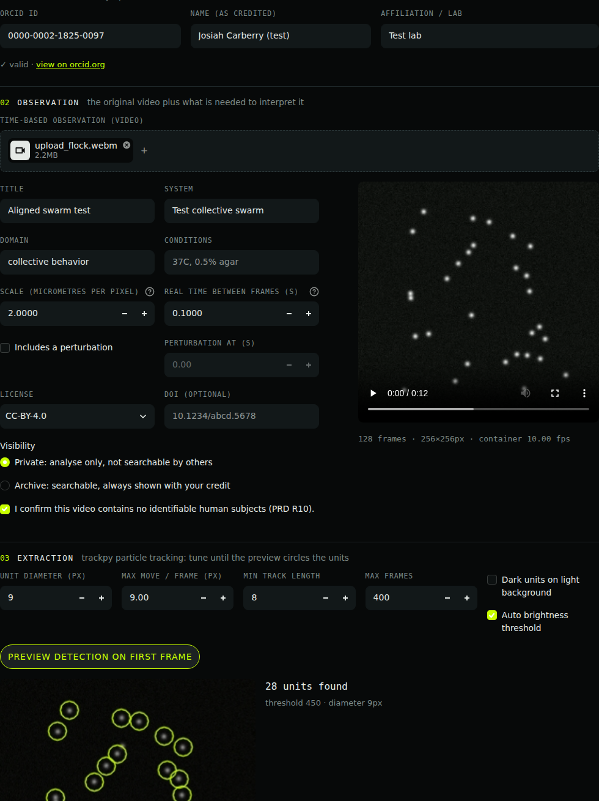
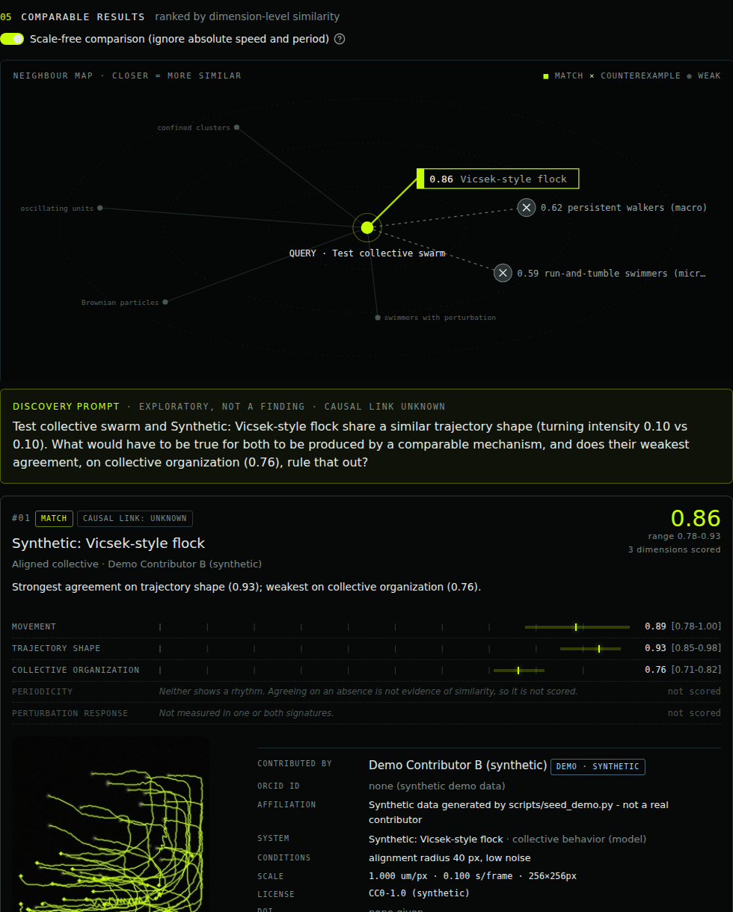

# Project Seek — working model v0.1

> Google lets us search what we can name; Seeker explores whether we can search what we can observe.

A working vertical slice of the Seeker PRD: upload a video of a moving system, track what moves, turn the
dynamics into a **behavioral signature**, and see which archived systems behave alike, with the evidence,
the uncertainty, and the researcher behind every result.




---

## Run it (macOS)

You need Python 3.10 or newer (`python3 --version`).

```bash
cd project-seek
python3 -m venv .venv            # 1. make an isolated environment
source .venv/bin/activate        # 2. switch into it (do this every new terminal)
pip install -r requirements.txt  # 3. install dependencies (~1-2 min)
python scripts/seed_demo.py      # 4. optional: load 7 synthetic systems to compare against (~1 min)
streamlit run app.py             # 5. opens http://localhost:8501
```

You can also load the demo archive from the app's sidebar instead of step 4.
Everything is stored locally in `data/` (videos, trajectory tables, and `seek.sqlite3`). Delete that folder to start fresh.

Run the tests with `pytest`.

---

## What it does, step by step

The app walks through five numbered steps that map onto the PRD's architecture layers.

| Step | In the app | PRD layer | Code |
|---|---|---|---|
| 01 Contributor | ORCID iD (checksum-validated), name, affiliation | Acquire, provenance | `seek/identity.py` |
| 02 Observation | Upload a video plus scale, frame interval, license, DOI, visibility, no-human-subjects confirmation | Acquire, Identify & contextualize | `seek/storage.py`, `seek/db.py` |
| 03 Extraction | trackpy finds and links moving units; preview detection on the first frame | Normalize, Measure | `seek/extraction.py` |
| 04 Signature | 11 features in 5 dimensions, each with a bootstrap uncertainty | Represent, Index | `seek/schema.py`, `seek/features.py` |
| 05 Compare | Ranked results, neighbour map, discovery prompt, counterexamples, credit, research actions | Compare, Explore, Interpret | `seek/compare.py`, `seek/ui.py`, `app.py` |

### 1. Insert a video for analysis
Upload MP4, MOV, AVI, WebM, MKV or M4V. The original file is kept untouched and fingerprinted with SHA-256 (R1).
The same file can't be added twice, and anyone can check that a signature came from exactly this file.

### 2. Signature schema and data model
Every signature can be traced back through the run that measured it, to the observation, to the person who uploaded it:

```
contributors 1───* observations 1───* extraction_runs 1───1 signatures
                                 \
                                  *── decisions (save / reject / hypothesis)
```

- **contributors**: ORCID iD, name, affiliation. Real uploads must have a valid ORCID. Demo rows are flagged `is_demo`.
- **observations**: video path and hash, system, domain, conditions, µm per pixel, seconds per frame, optional perturbation time, license, DOI, visibility (`private` or `archive`), and the no-human-subjects attestation (R10), which the database itself enforces.
- **extraction_runs**: tool, version, parameters, and the path to the raw trajectory CSV. Raw measurements are stored apart from the derived signature (R3).
- **signatures**: feature values, uncertainty, quality warnings, and schema version.
- **decisions**: what the researcher did with a comparison (R12).

The full SQL is in `seek/db.py` and on the app's **Data model** page.

### 3. Extraction
[trackpy](https://soft-matter.github.io/trackpy/) (Crocker–Grier particle tracking, widely used in microscopy) locates blobs of a given size in each frame and links them into trajectories.
Nothing is trained. Pixels become micrometres and frames become seconds using the scale you enter, so signatures from different microscopes use the same units.
If units aren't being picked up, adjust *unit diameter*, *dark units on light background*, or the brightness threshold, and use **Preview detection** to check.

The signature features are:

| Dimension | Features | Scale-free? |
|---|---|---|
| Movement | mean speed (µm/s), speed variability | speed: no, variability: yes |
| Trajectory shape | straightness, turning intensity, MSD exponent α | yes |
| Collective organization | alignment (corrected for chance), Clark–Evans clustering ratio | yes |
| Periodicity | periodicity strength, dominant period (s) | strength: yes, period: no |
| Perturbation response | response ratio, recovery time (s) | ratio: yes, time: no |

Uncertainty comes from bootstrapping: the tracks (or frames) are resampled 40 times and the spread is reported.
Anything that can't be measured stays empty rather than guessed. For example, perturbation response is only measured if you give a perturbation time.

### 4. Comparable results and how they're scored
- **Per feature:** `similarity = exp(-|difference| / tolerance)`, on a log scale for speeds and times. The tolerance is the difference at which similarity falls to 0.37. It's listed for every feature on the Data model page.
- **Per dimension:** the average of that dimension's feature similarities. The uncertainty of each feature carries into a low–high band.
- **Headline number:** the average of the scored dimensions. The dimension breakdown is always shown next to it (R4).
- **Scale-free mode (default):** only unitless features are scored, so a bacterium and a flock are compared on *how* they move, not how fast. Turn it off to score absolute speed and period too.
- **Match:** average ≥ 0.65 across at least 3 measured dimensions, with none of them clearly different.
- **No meaningful match (R6):** shown when nothing qualifies. The closest candidates are listed as weak, so you can see why.
- **Counterexample (R7):** ≥ 0.75 on one dimension and ≤ 0.35 on another. The sharpest three are shown next to the matches.
- **Shared absence:** if neither system has a rhythm, that agreement is displayed but not scored.
- **Causal link:** always `unknown` (R8). The discovery prompt is phrased as a question, never a conclusion.

In the demo archive, run-and-tumble swimmers at micro scale and the same dynamics at ~50× the spatial scale score **0.87**. That's the scale-free idea working as intended.

### 5. Trust interface (contributor credit)
Every result card carries a credit block: contributor, ORCID link, affiliation, system and conditions, scale, license, DOI, upload date and hash, and the exact extraction method and parameters.
Synthetic demo rows are badged **demo · synthetic**. Private uploads are compared against the archive but never shown to others. Archive uploads always appear with their credit.

---

## Known limitations (be upfront about these)
- **ORCID is checked, not authenticated.** The checksum catches typos, but anyone could type someone else's iD. Sign-in with ORCID (OAuth) is the next step before real contributors use this.
- **The demo archive is synthetic.** Tolerances and thresholds are hand-set and haven't been validated by domain experts yet. That validation is PRD section 15, step 4: expert-rated useful / weak / misleading pairs.
- **trackpy suits blob-like units** (cells, particles, small organisms). Branching networks (fungi, vasculature) need a graph-extraction path such as skeletonization, which isn't built yet.
- Clark–Evans ignores edge effects. Alignment needs 3 or more moving units per frame. Periodicity needs tracks of at least 32 steps.
- Local, single-user SQLite. Fine for a prototype, not for a shared archive.

## Repository layout
```
app.py                  Streamlit UI (Seeker Terminal)
seek/identity.py        ORCID validation
seek/storage.py         video storage + SHA-256 + probing
seek/db.py              SQLite data model and provenance queries
seek/extraction.py      trackpy tracking, unit normalization, overlays
seek/schema.py          signature schema (features, dimensions, tolerances)
seek/features.py        signature computation + bootstrap uncertainty
seek/compare.py         similarity, no-match, counterexamples, discovery prompt
seek/pipeline.py        end-to-end ingest
seek/demo.py, seed.py   synthetic demo systems
tests/                  24 tests, including tracked-vs-ground-truth checks
```
